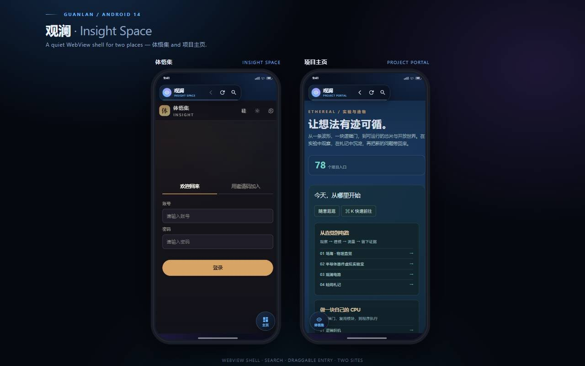

# 观澜 · Insight Space

<p align="center">
  <strong>A calm Android WebView container for Insight Space and web projects.</strong><br>
  <em>Fast navigation, thoughtful loading states, and a compact floating UI.</em>
</p>

> **中文**：观澜把「体悟集」与项目主页收进一个轻量 Android 容器，用悬浮胶囊、可拖动入口和 URL 搜索减少浏览干扰。  
> **English**: Guanlan is a lightweight Android container for Insight Space and web projects, with a compact floating capsule, draggable navigation and URL/search support.

## 亮点 Highlights

- **轻量 WebView / Lightweight WebView**：专注内容，不套厚重浏览器壳。
- **悬浮导航 / Floating navigation**：顶部胶囊、可拖动圆钮、返回/刷新/搜索。
- **安全边界 / Clear security boundary**：强制 HTTPS、外链交给系统浏览器、无 JavaScript Bridge。
- **真实设备打磨 / Device-aware polish**：处理 Android 14 edge-to-edge、软键盘、下载、文件选择和全屏媒体。

## Tech stack

`Java` · `Android WebView` · `Android SDK 34` · `minSdk 29` · `HTTPS-only navigation`

## English

Guanlan keeps a focused reading surface around Insight Space and the project portal. Same-site pages stay inside the app, external domains open in the system browser by default, and search-entered HTTPS pages can remain in the current browsing session. The app includes explicit error states, loading progress, downloads, file selection and HTML5 full-screen media support.

一个面向 Android 14 的轻量 WebView 应用，把 **体悟集（Insight Space）** 和 **观澜项目主页** 收进同一个安静的容器里。

打开应用默认进入：

`https://etherealnymph.github.io/web-projects/insight-space/index.html`

右下角圆形按钮的「主页」进入：

`https://etherealnymph.github.io/web-projects/`



---

## 直接安装

APK 已经编译、对齐并签名：

```
dist/Guanlan-Insight-1.3.0.apk
```

把 APK 传到 Android 手机，点击安装，按系统提示允许「安装未知应用」即可。安装包约 67 KB。

- 包名：`com.etherealnymph.guanlan`
- 版本：`1.3.0`（versionCode 5）
- minSdk：29（Android 10）
- targetSdk / compileSdk：34（Android 14）
- 签名：APK Signature Scheme v3（minSdk 29，Android 10+ 直接校验）
- 权限：仅 `INTERNET`、`ACCESS_NETWORK_STATE`
- SHA-256：`42290a5f887e17099448903d8260dc9d63c514c6df8ddedbf959589b58ec737e`

## 1.3.0 全子站、可拖动入口与 URL 搜索

- **所有 `/web-projects/` 子站** 都留在 WebView 内，不再只认两个固定首页；在子站里点击右下角圆钮会先回到项目主页。
- **圆形按钮可拖动**：按住拖动，松手后吸附到左/右边缘，垂直位置自由；位置保存到 SharedPreferences，下次启动和旋转后保持。
- **URL / 搜索入口**：顶栏新增放大镜。点开后可以输入完整 URL、域名、`/web-projects/` 路径，或普通关键词。
  - URL / 域名 → 直接在 WebView 打开；
  - `/web-projects/...` 或 `web-projects/...` → 补全为观澜子站；
  - 普通关键词 → 使用 Bing 搜索；
  - `http://` 明文链接 → 交给系统浏览器（应用本身仍禁止明文流量）。
- 从 URL / 搜索进入外部 HTTPS 页面后，该次浏览会留在应用内，搜索结果和站内链接可以继续点；回到观澜页面后，再点击外部链接仍交给系统浏览器。
- 搜索框默认填入当前地址并全选，方便直接改路径或输入新关键词；返回键优先关闭搜索框。

## 1.2.0 悬浮界面减负

根据 OPPO 实机截图，上一版的全宽顶栏和全宽底栏占用了太多阅读面积，而且 WebView 使用 padding，页面里的固定头部会滑到顶栏下方。1.2.0 调整：

- 顶栏改为 **220 × 50dp 的悬浮胶囊**：品牌标记、观澜 / INSIGHT SPACE、后退、刷新；去掉不常用的前进按钮。
- 底栏改为 **右下角 60dp 圆形边缘按钮**：在体悟集里显示「主页」，点击打开项目主页；在项目主页里显示「体悟集」，点击切回体悟集。
- WebView 从 padding 改为 **layout margins**：页面从顶栏下方开始，站点自己的固定头部不会再钻到胶囊下面。
- 页面底部延伸到导航栏附近，只留右下角 60dp 圆形按钮悬浮覆盖，整体遮挡面积明显减小。
- 顶部/底部都继续跟随状态栏、导航栏和软键盘 inset；键盘弹出时圆形按钮自动隐藏。

## 1.1.1 启动闪退修复（OPPO ColorOS）

1.1.0 在 OPPO PFTM10（Android 14 / ColorOS）上启动时报：

```text
java.lang.NullPointerException: Attempt to invoke virtual method
'android.view.WindowInsetsController
com.android.internal.policy.DecorView.getWindowInsetsController()'
on a null object reference
    at PhoneWindow.getInsetsController(...)
    at MainActivity.configureWindow(...)
```

原因是 OPPO 的 `PhoneWindow.getDecorView()` 在 `setContentView()` 之前可能返回 null，而 1.1.0 在 `configureWindow()` 里提前调用了 `window.getInsetsController()`。

1.1.1 的修复：

- 将 `setDecorFitsSystemWindows()` / `getInsetsController()` 全部移到 `setContentView()` 之后执行
- 对这些 OEM Window 调用加 try/catch，边缘到边缘只是视觉增强，失败也不能拖垮启动
- 启动失败时仍会显示错误页并自动复制堆栈，作为兜底

1.1.0 还做了这些启动收敛：移除自定义启动页 / 渐变启动图标、移除预测性返回注册、移除 WebView force dark 调用、移除启动过渡和刘海模式主题属性，并给 `onCreate` 加了完整异常兜底。

如果 1.1.1 仍然闪退，请重新打开一次应用，把自动复制的日志直接粘贴过来，或截图错误页。日志里包含设备型号、Android 版本和完整堆栈。

## 界面与交互

- **默认入口**：启动后直接载入「体悟集」，顶部有紧凑的观澜 / INSIGHT SPACE 悬浮胶囊。
- **两个站点 + 全部子站**：右下角圆形按钮在「主页」和「体悟集」之间切换；项目主页下的任意子站都留在 WebView 内。
- **顶部操作**：后退、刷新、网址 / 搜索；刷新图标在加载时旋转，胶囊底部有一条渐变进度线。
- **可拖动圆钮**：长按拖动圆形入口，松手吸附到左右边缘，位置会记住。
- **URL 搜索**：可输入 URL、域名或关键词；关键词走 Bing，HTTPS 页面留在应用内，HTTP 交给系统浏览器。
- **Android 返回键**：优先关闭搜索框，其次在 WebView 内后退，没有历史时才退出应用。
- **加载态**：自定义轨道 / 眼睛标记动画，显示连接进度百分比。
- **错误态**：离线、超时、DNS 失败、HTTP 4xx/5xx、SSL 失败分别给出中文提示，可「重新加载」或直接「前往项目主页」。
- **外链**：观澜同站留在应用内；从观澜页面点击的外部域名、`mailto:`、`tel:` 等交给系统浏览器 / 对应应用。通过搜索进入的外部 HTTPS 站点会在本次浏览会话内留在应用内。
- **文件与媒体**：支持网页里的文件选择上传、下载（交给系统 DownloadManager），以及 HTML5 视频全屏。
- **登录与会话**：启用 DOM Storage、数据库和第一方 Cookie，退出再进仍保留登录状态；应用本身不收集任何数据。
- **全面屏**：edge-to-edge 绘制，处理状态栏、导航栏、刘海和软键盘 inset；键盘弹出时圆形按钮自动隐藏。

## 设计说明

整体沿用项目主页的深夜蓝与蓝色 / 紫色渐变，而不是套一层白色浏览器壳：

- 背景：`#070C18` 深海军蓝，叠加两团低透明度径向光晕。
- 悬浮面板：256 × 50dp 顶部胶囊（品牌、后退、刷新、搜索）与 60dp 可拖动圆形按钮，半透明深色玻璃、18dp / 全圆角、1dp 冷色描边。
- 品牌标记：一个「眼睛 / 涟漪」组合的矢量图形，用于应用图标和加载动画。
- 字体：系统 sans-serif / sans-serif-medium，中文优先，英文使用较宽字距作为辅助信息。
- 动效：加载时轨道弧线旋转；页面载入后加载层淡出；底部入口有按压反馈和选中描边。

## 项目结构

```
GuanlanInsight/
├─ app/src/main/
│  ├─ java/com/etherealnymph/guanlan/
│  │  ├─ MainActivity.java        # WebView 容器、导航、错误/加载/全屏、下载、文件选择
│  │  ├─ OrbitLoadingView.java    # 纯 Canvas 绘制的加载动画
│  │  ├─ CrashLog.java            # 崩溃日志落盘 / 读取
│  │  └─ GuanlanApp.java          # 全局异常捕获
│  ├─ res/
│  │  ├─ layout/activity_main.xml # 悬浮顶栏、双入口底栏、加载层、错误层
│  │  ├─ drawable/                # 玻璃卡片、渐变、图标
│  │  ├─ mipmap-anydpi-v26/       # 自适应图标
│  │  ├─ mipmap-anydpi-v33/       # Android 13+ 单色主题图标
│  │  └─ values*/                 # 颜色、文案、主题
│  └─ AndroidManifest.xml
├─ keystore/guanlan-demo.jks      # 演示签名密钥（见下方说明）
├─ dist/Guanlan-Insight-1.3.0.apk
├─ preview/design.html            # 可交互的双屏设计预览
├─ build-apk.ps1                  # 不依赖 Gradle 的可复现构建脚本
├─ gradlew / gradlew.bat
└─ build.gradle.kts / settings.gradle.kts
```

## 自己构建

### 方式一：Android Studio

用 Android Studio 打开 `GuanlanInsight` 目录，等待 Gradle Sync，然后 Run。

- 需要 JDK 17
- AGP 8.5.2 / Gradle 8.7
- compileSdk 34

### 方式二：Gradle 命令行

```bash
./gradlew :app:assembleDebug
# Windows
gradlew.bat :app:assembleDebug
```

输出在 `app/build/outputs/apk/debug/`。

如果访问 `services.gradle.org` 较慢，可以把 `gradle/wrapper/gradle-wrapper.properties` 中的 `distributionUrl` 换成：

`https://mirrors.cloud.tencent.com/gradle/gradle-8.7-bin.zip`

### 方式三：无 Gradle 脚本（生成当前 dist 里的 APK）

```powershell
powershell -ExecutionPolicy Bypass -File .\build-apk.ps1
```

脚本会依次执行 `aapt2 compile/link`、`javac`、`d8`、打包 `classes.dex`、`zipalign`、`apksigner`，最后输出到 `dist/`。

默认会优先寻找项目旁边的 `_tools/jdk` 与 `_tools/sdk`；找不到时使用 Android Studio 常见路径。也可以显式传入：

```powershell
.\build-apk.ps1 `
  -JdkPath 'C:\Program Files\Android\Android Studio\jbr' `
  -SdkPath "$env:LOCALAPPDATA\Android\Sdk"
```

需要 `build-tools;34.0.0` 和 `platforms;android-34`。

## 签名说明

公开仓库不包含演示签名密钥。构建侧载 APK 时请使用自己的 keystore，并通过 `APK_KEYSTORE_PASSWORD` 环境变量提供口令；发布到应用商店前请妥善保管正式密钥。

## 修改入口地址

编辑 `app/src/main/java/com/etherealnymph/guanlan/MainActivity.java` 顶部的三个常量：

```java
private static final String INSIGHT_URL = "https://.../insight-space/index.html";
private static final String PORTAL_URL  = "https://.../web-projects/";
private static final String ALLOWED_HOST = "etherealnymph.github.io";
```

如果要允许更多站内域名，修改 `handleUri()` / `sectionForUrl()` 中的 host 判断即可。

## 安全与边界

- 不注册 JavaScript Bridge，不向网页暴露原生对象。
- 强制 HTTPS；`usesCleartextTraffic=false`，混合内容一律拒绝。
- SSL 证书错误直接取消加载，不提供「继续访问」。
- 第三方 Cookie 默认关闭；登录态由第一方 Cookie + DOM Storage 维持。
- 外部域名默认交给系统浏览器，不在 WebView 内静默加载。
- 相机 / 麦克风的网页权限请求默认拒绝；普通图片、文件上传通过系统文件选择器完成。
- `blob:` / 本应用暂不支持的文件下载会给出提示。

## 已验证

- 1.3.0：`aapt2` 资源编译、链接通过
- 1.3.0：`javac` / `d8` 编译通过
- 1.3.0：APK Signature Scheme v3 签名校验通过
- 1.3.0：`zipalign` 4 字节对齐校验通过
- 1.3.0：`aapt2 dump badging` 确认 package / targetSdk / launcher activity
- 1.0.0：`gradlew :app:assembleDebug` 曾构建通过（AGP 8.5.2 / Gradle 8.7 / JDK 17）
- 设计预览在 Chromium 中按 390 × 844 手机视口渲染通过

当前环境没有连接 Android 真机或模拟器，因此未做设备端点击回归；1.1.1 的 OPPO 修复是根据实际崩溃堆栈做的定点修复，1.3.0 的悬浮界面 / 搜索 / 拖动已按 390 × 844 手机视口做设计预览。如果仍闪退，应用会自动复制崩溃日志，直接粘贴反馈即可。
